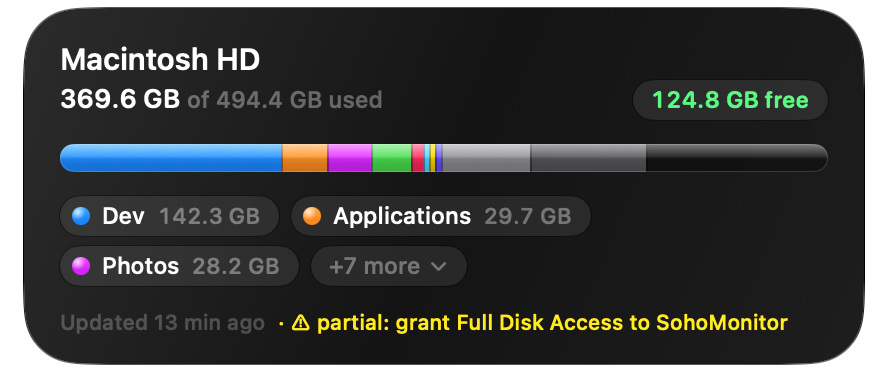

# soho-monitor


[](https://github.com/francoisgn/soho-monitor/actions/workflows/ci.yml)


[](LICENSE)
[](https://buymeacoffee.com/francoisgn)

> A native macOS system monitor for a small office / home office: disk usage by **your own categories**, live CPU,
> memory and network, and the services around the Mac (Synology NAS, UniFi network, Claude plan usage), in a
> menu bar extra and a movable Liquid Glass desktop panel.

**TL;DR**: one SwiftUI app, configured by a YAML file you version with your dotfiles. It replaces an Übersicht
widget (shell + JSX) with real glass, live sampling and no helper binaries. Status: the **disk module** works (v0.1);
the other modules are planned, see the [issues](https://github.com/francoisgn/soho-monitor/issues).

## Features

| Module | What it shows | Status |
|---|---|---|
| Disk | Usage of the startup volume by configurable groups and categories (YAML), segmented bar, legend, top 3 folders per group, free space thresholds | 🔵 migrating |
| System | CPU, GPU, memory, network cards with a large figure, a thin bar, a history sparkline, busiest processes; optional menu bar indicators | ⚪ planned |
| Synology | NAS volumes, health, load, containers, through the DSM API with a dedicated read-only account | ⚪ planned |
| UniFi | WAN, devices, clients, throughput, through the UniFi Network local integration API | ⚪ planned |
| Claude | Usage of the operator's Claude plans (session and weekly limits, reset times) | ⚪ planned |

Design: Apple system fonts (SF Pro, SF Pro Rounded for figures), native materials and Liquid Glass (macOS 26),
subtle gradients, cards inspired by the system monitor of [OnlySwitch](https://github.com/jacklandrin/OnlySwitch)
(MIT).

## Disk module

A desktop card (above the wallpaper, below every window, on all Spaces) and a menu bar extra:



- **Card**: volume name, "X of Y used", free-space pill (orange / red under the configured thresholds), one
  continuous segmented bar (groups by size, `macOS` and `Other` last), legend chips with their size and ⚠︎ when a
  group was measured partially. Hover a segment or a chip for the detail of its categories; click a chip for the
  group's three biggest folders (name, path, size, gauge). Drag the card to move it (position remembered),
  double-click it to put it back in the bottom-left corner.
- **Menu**: summary line ("Macintosh HD: 183.9 GB free of 494.4 GB"), last update or "Scanning…", configuration or
  scan errors, Show / Hide Panel, Rescan Now, Quit.
- **Scan**: every configured path is measured with `du -k -d 1` (one pass gives its size and its direct
  sub-folders) at background quality of service, every `scan_interval_minutes` (default 30) and on demand. One scan
  at a time, across processes too (a lock file next to the cache: `--scan` refuses while the app scans, and the
  reverse). A failed scan is retried after one interval, not at once. A full pass of a well-filled home folder takes several minutes. iOS simulator runtimes come from
  `xcrun simctl runtime list -j`; the APFS container size, free space and the macOS volumes from `diskutil`.
  The last result is cached in `~/Library/Caches/soho-monitor/disk-snapshot.json`, so the card shows figures at
  launch.
- **Counting rules**: categories are measured in file order; a path counted by an earlier category is subtracted
  from the paths that contain it (net values, never twice, at least 0); a path inside one already counted adds
  nothing. `macOS` = the container's volumes except Data (System, Preboot, Recovery, VM, Update); `Other` = used −
  macOS − everything counted, at least 0 (`du` counts APFS clones in full, so categories can exceed the real use).
  The top 3 of a group are the direct sub-folders of its paths, each net of what was counted at or below it.
- **Full Disk Access**: without it, protected folders (Mail, Messages, other apps' containers) are read partially:
  their chip shows ⚠︎ and the footer says so. Grant it to `SohoMonitor.app` in System Settings › Privacy & Security ›
  Full Disk Access. An ad hoc signature changes at every build: grant it again after reinstalling.
- **Headless scan**: `SohoMonitor.app/Contents/MacOS/SohoMonitor --scan` runs one scan with the current
  configuration, writes the cache and prints the groups (useful to check the figures, or to fill the cache from a
  terminal that already has disk access).

### Configuration

One YAML file, `~/.config/soho-monitor/config.yaml` (or `$XDG_CONFIG_HOME/soho-monitor/config.yaml`, or the path in
`$SOHO_MONITOR_CONFIG`). Start from [`config/example.yaml`](config/example.yaml); a symbolic link to a file in your
dotfiles works. The app checks the file every 2 seconds and reloads it when it changes; an invalid file is reported
in the card and the menu (every problem, with its line) and the last valid configuration stays in use. Unknown keys
are warnings.

| Key | Type | Default | Meaning |
|---|---|---|---|
| `disk.scan_interval_minutes` | integer, 1–1440 | 30 | Minutes between two automatic scans |
| `disk.free_space.warning_below_percent` | number, 0–100 | 20 | Free space below this share of the disk: orange pill |
| `disk.free_space.critical_below_percent` | number, 0–100 | 10 | Below this: red pill (must be lower than the warning) |
| `disk.categories` | list, required | — | Categories, measured in this order |
| `disk.categories[].group` | string, required | — | Colour in the bar and chip in the legend; `macOS` and `Other` are reserved |
| `disk.categories[].label` | string | the group | Line in the group's detail; `group`/`label` must be unique |
| `disk.categories[].paths` | list of strings | — | Folders or files; `~` and globs (`*`, `?`, `[…]`) allowed |
| `disk.categories[].source` | `ios-runtimes` | — | Instead of `paths`: iOS simulator runtimes (size from `simctl`) |

A category has either `paths` or `source`. Put the most specific paths first (DerivedData before
`~/Library/Developer`). Quote a path that starts with a YAML indicator (`*`, `&`, `!`, `[`, `{`).

## Architecture

```text
 ~/.config/soho-monitor/config.yaml  (versioned in your dotfiles)
            │ watched, reloaded live
            ▼
 ┌──────────────────────── SohoMonitor.app (menu bar, LSUIElement) ────────────────────────┐
 │  SohoMonitorCore (Swift package library, unit-tested)                                   │
 │    Config (Yams) ─▶ Collectors: disk (du, background, low priority) · system (Mach,     │
 │    sysctl, getifaddrs) · synology (DSM API) · unifi (integration API) · claude usage     │
 │                                  │ snapshots (Codable, cached to disk)                  │
 │  SohoMonitor (SwiftUI)           ▼                                                      │
 │    MenuBarExtra ── desktop panel (NSPanel at desktop level, movable, glass cards)        │
 └──────────────────────────────────────────────────────────────────────────────────────────┘
   Secrets: macOS Keychain only. Network: only the hosts named in the configuration.
```

| Path | Role |
|---|---|
| `Package.swift` | Swift package: `SohoMonitorCore` (library), `SohoMonitor` (app), tests |
| `Sources/SohoMonitorCore/` | Configuration, collectors, models: no UI, unit-tested |
| `Sources/SohoMonitor/` | SwiftUI app: menu bar extra, desktop panel, cards |
| `Tests/SohoMonitorCoreTests/` | Swift Testing suites |
| `config/` | Example configuration |
| `scripts/bundle-app.sh` | Release build → `build/SohoMonitor.app` (menu bar app, ad hoc signature) |
| `.harness/`, `.claude/`, `CLAUDE.md`, `AGENTS.md` | Rules for the coding agents ([Belayline](https://github.com/francoisgn/belayline-agentic-harness)) |

## Quick start

Requirements: macOS 26 or later, Xcode 26 or later (Swift 6.2 toolchain).

```sh
git clone git@github.com:francoisgn/soho-monitor.git && cd soho-monitor
swift build && swift test          # library and tests
scripts/bundle-app.sh --install    # build/SohoMonitor.app, copied to ~/Applications
open ~/Applications/SohoMonitor.app
```

Open `Package.swift` in Xcode to work on the UI. Disk categories need **Full Disk Access** for `SohoMonitor.app`
(System Settings › Privacy & Security › Full Disk Access).

## Development

```sh
pre-commit install            # once per clone (hooks pinned; swift-format comes with the toolchain)
pre-commit run --all-files    # swift-format, ShellCheck, actionlint, zizmor, markdownlint, JSON/YAML, gitleaks
scripts/local-check.sh        # the same as CI, with a summary
```

CI: linters on Linux; `swift format lint`, `swift build`, `swift test` and the app bundle on GitHub-hosted macOS 26;
full-history gitleaks. Coding agents follow [`CLAUDE.md`](CLAUDE.md) / [`AGENTS.md`](AGENTS.md); see also
[CONTRIBUTING.md](CONTRIBUTING.md), [SECURITY.md](SECURITY.md) and [CHANGELOG.md](CHANGELOG.md).

## License

[MIT](LICENSE). The vendored harness files in `.harness/` carry Belayline's own MIT licence
([`.harness/LICENSE`](.harness/LICENSE)).

## Support

If soho-monitor saves you a trip to Activity Monitor or a NAS dashboard, you can buy me a coffee:

[](https://buymeacoffee.com/francoisgn)
