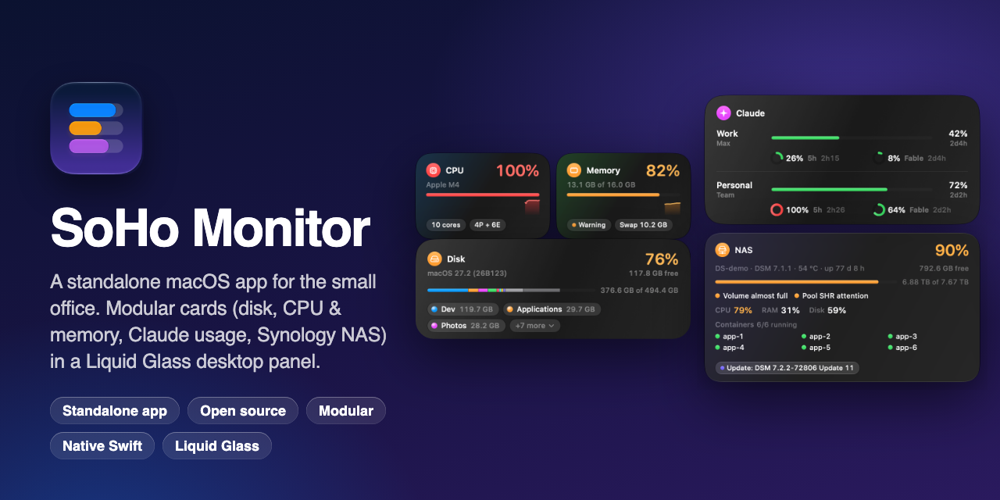
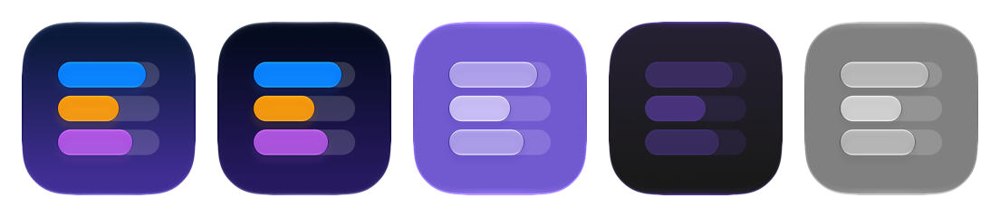
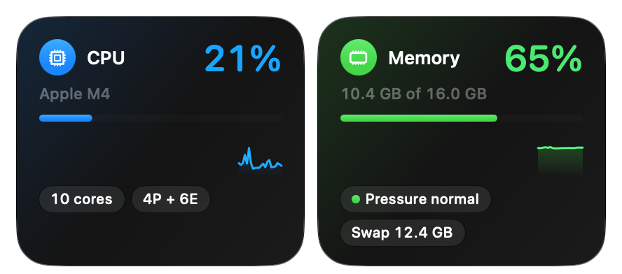
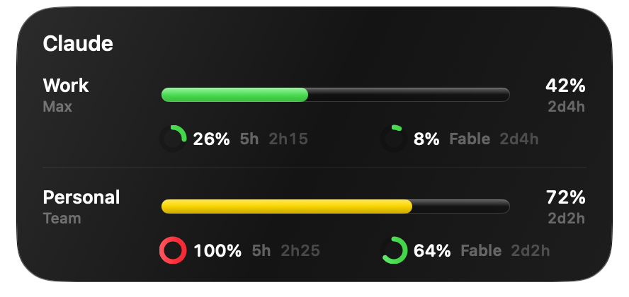

# soho-monitor


[](https://github.com/francoisgn/soho-monitor/actions/workflows/ci.yml)


[](LICENSE)
[](https://buymeacoffee.com/francoisgn)

> A native macOS system monitor for a small office / home office: disk usage by **your own categories**, live CPU,
> memory and network, and the services around the Mac (Synology NAS, UniFi network, Claude plan usage), in a
> menu bar extra and a movable Liquid Glass desktop panel.



**TL;DR**: one SwiftUI app, configured by a YAML file you version with your dotfiles. It replaces an Übersicht
widget (shell + JSX) with real glass and live sampling; the only helper is a small Node script for the Claude card
(official Claude Agent SDK). Status: the **disk**, **CPU / memory** and **Claude** cards work; Synology is in progress
(password, TLS policy and login test done, data cards next) and UniFi is planned, see the [issues](https://github.com/francoisgn/soho-monitor/issues).

## Features

| Module | What it shows | Status |
|---|---|---|
| Disk | Usage of the startup volume by configurable groups and categories (YAML), segmented bar, legend, top 3 folders per group, free space thresholds | 🟢 done |
| System | CPU and memory cards (large figure, thin bar, sparkline of the last 120 samples, chip and core pills, memory pressure and swap) on the desktop panel; GPU, network, busiest processes and menu bar indicators to come | 🔵 in progress |
| Synology | NAS volumes, health, load, containers, through the DSM API with a dedicated read-only account. Done: `synology:` config, password in the Keychain (credential window, with a test of the saved password from the window or the NAS card), per-host TLS policy (system, pinned SHA-256, opt-out), DSM login client, polling engine with backoff for the data cards, which come next | 🔵 in progress |
| UniFi | WAN, devices, clients, throughput, through the UniFi Network local integration API | ⚪ planned |
| Claude | Usage of your Claude plans, one block per Claude Code profile: weekly limit bar, 5-hour session and per-model weekly lines (ring, percent, short reset time), pace colours | 🟢 done |

Design: Apple system fonts (SF Pro, SF Pro Rounded for figures), native materials and Liquid Glass (macOS 26),
subtle gradients, cards inspired by the system monitor of [OnlySwitch](https://github.com/jacklandrin/OnlySwitch)
(MIT).

App icon: three glass gauges (disk, CPU, Claude) on a night blue → indigo gradient, a layered Icon Composer file
(`Resources/AppIcon.icon`) that macOS renders in default, dark, tinted and clear styles:

<p align="center"></p>

## Disk module

A desktop card (above the wallpaper, below every window, on all Spaces) and a menu bar extra:

<p align="center"></p>

- **Card**: the CPU and memory cards' header (icon, "Disk", share of the disk used as the large figure; the volume
  name is read by VoiceOver), "X of Y used", free-space pill (orange / red under the configured thresholds), one
  continuous segmented bar (groups by size, `macOS` and `Other` last), legend chips with their size and ⚠︎ when a
  group was measured partially. The legend shows the three biggest configured groups (`macOS` and `Other` only when
  fewer are configured); "+N more" unfolds every chip until "Less" or until the panel is hidden. Hover a segment
  (free space included) or a chip to highlight it and read its name, size and share of the bar in place of "X of Y
  used"; click a chip for the group's three biggest folders (name, path, size, gauge). Drag any card to move the
  panel, double-click one to put it back in its default place: the top-left corner of the main screen, under the menu
  bar. The panel hangs from its top-left corner (the one remembered), so it grows downward as cards are added or
  expand, and it is kept inside the screen (a panel taller than the screen keeps its top visible).
- **Menu**: summary line ("Macintosh HD: 183.9 GB free of 494.4 GB"), last update or "Scanning…", configuration or
  scan errors, Show / Hide Panel, Tile Opacity, Rescan Now, Quit.
- **Tile Opacity** (menu): Glass (default, the plain Liquid Glass look), Light Frost, Frosted, Solid or Opaque, applied
  at once to the CPU, memory, disk and Synology cards and remembered across launches. Nothing more transparent than
  plain glass: its blur keeps the text legible over a busy wallpaper. With Reduce Transparency on (System Settings ›
  Accessibility › Display), the cards are opaque whatever the choice.
- **Scan**: every configured path is measured with `du -k -d 1` (one pass gives its size and its direct
  sub-folders) at background quality of service, every `scan_interval_minutes` (default 30) and on demand. One scan
  at a time, across processes too (a lock file next to the cache: `--scan` refuses while the app scans, and the
  reverse). A failed scan is retried after one interval, not at once. A full pass of a well-filled home folder takes several minutes. iOS simulator runtimes come from
  `xcrun simctl runtime list -j`; the APFS container size, free space and the macOS volumes from `diskutil`.
  The last result is cached in `~/Library/Caches/soho-monitor/disk-snapshot.json`, so the card shows figures at
  launch.
- **Counting rules**: categories are measured in file order; a path counted by an earlier category is subtracted
  from the paths that contain it (net values, never twice, at least 0); a path inside one already counted adds
  nothing. `macOS` = the container's volumes except Data (System, Preboot, Recovery, VM, Update); `Other` = used −
  macOS − everything counted, at least 0 (`du` counts APFS clones in full, so categories can exceed the real use).
  The top 3 of a group are the direct sub-folders of its paths, each net of what was counted at or below it.
- **Full Disk Access**: without it, protected folders (Mail, Messages, other apps' containers) are read partially:
  their chip shows ⚠︎ and the footer says so. Grant it to `SohoMonitor.app` in System Settings › Privacy & Security ›
  Full Disk Access. Signed with your Apple Development certificate (found in the keychain), the grant survives
  rebuilds; an ad hoc signature (no certificate) changes at every build and needs it again.
- **Local Network**: macOS asks once whether SohoMonitor may reach devices on the local network (NAS, UniFi
  controller); without it a LAN host is unreachable (for an IP address: "blocked by macOS Local Network privacy").
  Allow it in System Settings › Privacy & Security › Local Network
  ([TN3179](https://developer.apple.com/documentation/technotes/tn3179-understanding-local-network-privacy)).
- **Headless scan**: `SohoMonitor.app/Contents/MacOS/SohoMonitor --scan` runs one scan with the current
  configuration, writes the cache and prints the groups (useful to check the figures, or to fill the cache from a
  terminal that already has disk access).

### Configuration

One YAML file, `~/.config/soho-monitor/config.yaml` (or `$XDG_CONFIG_HOME/soho-monitor/config.yaml`, or the path in
`$SOHO_MONITOR_CONFIG`). Start from [`config/example.yaml`](config/example.yaml); a symbolic link to a file in your
dotfiles works. The app checks the file every 2 seconds and reloads it when it changes; an invalid file is reported
in the card and the menu (every problem, with its line) and the last valid configuration stays in use. Unknown keys
are warnings.

| Key | Type | Default | Meaning |
|---|---|---|---|
| `disk.scan_interval_minutes` | integer, 1–1440 | 30 | Minutes between two automatic scans |
| `disk.free_space.warning_below_percent` | number, 0–100 | 20 | Free space below this share of the disk: orange pill |
| `disk.free_space.critical_below_percent` | number, 0–100 | 10 | Below this: red pill (must be lower than the warning) |
| `disk.categories` | list, required | — | Categories, measured in this order |
| `disk.categories[].group` | string, required | — | Colour in the bar and chip in the legend; `macOS` and `Other` are reserved |
| `disk.categories[].label` | string | the group | Line in the group's detail; `group`/`label` must be unique |
| `disk.categories[].paths` | list of strings | — | Folders or files; `~` and globs (`*`, `?`, `[…]`) allowed |
| `disk.categories[].source` | `ios-runtimes` | — | Instead of `paths`: iOS simulator runtimes (size from `simctl`) |

A category has either `paths` or `source`. Put the most specific paths first (DerivedData before
`~/Library/Developer`). Quote a path that starts with a YAML indicator (`*`, `&`, `!`, `[`, `{`).

## System module

Two glass cards above the disk card on the desktop panel:

<p align="center"></p>

- **CPU**: total usage of all cores (user + system + nice ticks over all ticks between two samples, from
  `host_processor_info`), chip name (`machdep.cpu.brand_string`), core count and the split per performance level
  (`hw.perflevelN`, e.g. "4P + 6E"); hover the figure for user / system. The first second shows "Sampling…": a rate
  needs two samples.
- **Memory**: used share and "used of total" (used = app + wired + compressed, the Activity Monitor-like split of
  `host_statistics64`; cached files and purgeable memory are not counted as used), breakdown on hover, memory
  pressure pill ("Normal" / "Warning" / "Critical", with a coloured dot; event driven: `DispatchSource`
  memory-pressure source, seeded by `kern.memorystatus_vm_pressure_level`), swap used (`vm.swapusage`). Sizes in
  binary units (16 GB = 16 GiB). The bar turns orange / red with the pressure level, or above 85 % / 95 % used when
  the pressure is unknown.
- **Sampling**: once per second, and only while the panel is on screen: hidden, or fully covered by windows
  (`NSWindow` occlusion state), nothing is sampled. After the Mac wakes, the first CPU sample is dropped rather than averaged over the sleep. A
  metric that cannot be read shows a dash and the reason in a red pill, never a fake 0 %.
## Claude module

A second card in the desktop panel, shown when the configuration lists Claude Code profiles:

<p align="center"></p>

- **Per profile**, in configuration order: its label and plan, a bar with the **weekly** limit (all models), its
  percent and reset; below, one line per other limit, two side by side: the **5-hour session** and each
  **per-model weekly** limit (e.g. Fable), as a small ring, the percent, the name and the time to the reset. Reset
  times are short: `44m`, `3h05`, `2d12h` (`now` once passed, `–` unknown); VoiceOver reads them in full.
- **Colours** (bar and rings): **green** while the usage keeps pace with the window, **yellow** when it runs ahead
  (more used than the elapsed share of the window: 20 % an hour on the 5-hour window, the elapsed share of the
  7 days on a weekly one), **red** at 90 % or more whatever the pace. The server's severity is a floor: a row it
  rates warning or critical is never shown milder. VoiceOver says "above pace" or "critical" in words.
- **States**: "Waiting for first update…"; a problem (not logged in, limits unavailable or none reported, Node.js
  or Claude Code not found, config directory not found, helper error or timeout) is written under the block and the
  last good figures stay; figures older than two refresh intervals are dimmed with their age.
<p align="center"></p>
<sub>Source: <a href="docs/diagrams/claude-usage.excalidraw">claude-usage.excalidraw</a> (excalidraw.com › Open).</sub>

- **Source** ([ADR 0001](docs/adr/0001-claude-usage-source.md)): a Node helper bundled in the app
  (`Contents/Resources/claude-usage/`) uses Anthropic's Claude Agent SDK to ask the **installed, unmodified
  `claude`** for the data behind `/usage`, with the profile's own login (`CLAUDE_CONFIG_DIR`). No prompt is sent
  (nothing is spent) and the app never reads a token, a credentials file or the Keychain. The figures come from
  your plan's usage on the server, so they include work done elsewhere.
- **Refresh**: every `claude.refresh_minutes` (default 5) and only while the panel is shown; showing it refreshes at
  once each profile last tried at least that long ago. One profile at a time, at background priority, 30 s timeout.
- **Requirements**: Node.js 18.14+ and Claude Code, found in your login shell's `PATH` or in `/opt/homebrew/bin`,
  `/usr/local/bin`, `~/.local/bin`; each profile logged in once (`CLAUDE_CONFIG_DIR=<dir> claude`, then `/login`).
  Building the app needs `npm` (`scripts/bundle-app.sh` installs the helper's pinned dependency from its lockfile).

| Key | Type | Default | Meaning |
|---|---|---|---|
| `claude.refresh_minutes` | integer, 1–1440 | 5 | Minutes between two refreshes while the panel is shown |
| `claude.accounts` | list | none (card off) | Claude Code profiles, shown in this order |
| `claude.accounts[].label` | string, required | — | Name in the card; unique |
| `claude.accounts[].config_dir` | string, required | — | The profile's `CLAUDE_CONFIG_DIR` (`~` allowed); unique; a missing directory is a warning and the app does not run Claude Code for it |

## Architecture

<p align="center"></p>
<sub>Source: <a href="docs/diagrams/architecture.excalidraw">architecture.excalidraw</a> (excalidraw.com › Open). Diagrams are exported to SVG by
<code>scripts/export-diagrams.sh</code> (Excalidraw's own export, font embedded).</sub>

| Path | Role |
|---|---|
| `Package.swift` | Swift package: `SohoMonitorCore` (library), `SohoMonitor` (app), tests |
| `Sources/SohoMonitorCore/` | Configuration, collectors, models: no UI, unit-tested |
| `Sources/SohoMonitor/` | SwiftUI app: menu bar extra, desktop panel, cards |
| `Helpers/claude-usage/` | Node helper of the Claude card (pinned Claude Agent SDK, lockfile), copied into the bundle |
| `Tests/SohoMonitorCoreTests/` | Swift Testing suites |
| `config/` | Example configuration |
| `Resources/AppIcon.icon/` | App icon (Icon Composer package: `icon.json` and SVG layers), compiled by `actool` |
| `docs/diagrams/` | README diagrams: Excalidraw sources and their SVG export (`scripts/export-diagrams.sh`, tooling outside the repository) |
| `scripts/bundle-app.sh` | Release build → `build/SohoMonitor.app` (menu bar app, Apple Development certificate if present, else ad hoc) |
| `.harness/`, `.claude/`, `CLAUDE.md`, `AGENTS.md` | Rules for the coding agents ([Belayline](https://github.com/francoisgn/belayline-agentic-harness)) |

## Quick start

Requirements: macOS 26 or later, Xcode 26 or later (Swift 6.2 toolchain); Node.js 18.14+ with `npm` and Claude
Code for the Claude card.

```sh
git clone git@github.com:francoisgn/soho-monitor.git && cd soho-monitor
swift build && swift test          # library and tests
scripts/bundle-app.sh --install    # build/SohoMonitor.app, copied to ~/Applications
open ~/Applications/SohoMonitor.app
```

Open `Package.swift` in Xcode to work on the UI. Disk categories need **Full Disk Access** for `SohoMonitor.app`
(System Settings › Privacy & Security › Full Disk Access).

## Development

```sh
pre-commit install            # once per clone (hooks pinned; swift-format comes with the toolchain)
pre-commit run --all-files    # swift-format, ShellCheck, actionlint, zizmor, markdownlint, JSON/YAML, gitleaks
scripts/local-check.sh        # the same as CI, with a summary
```

CI: linters on Linux; `swift format lint`, `swift build`, `swift test` and the app bundle on GitHub-hosted macOS 26;
full-history gitleaks. Coding agents follow [`CLAUDE.md`](CLAUDE.md) / [`AGENTS.md`](AGENTS.md); see also
[CONTRIBUTING.md](CONTRIBUTING.md), [SECURITY.md](SECURITY.md) and [CHANGELOG.md](CHANGELOG.md).

## License

[MIT](LICENSE). The vendored harness files in `.harness/` carry Belayline's own MIT licence
([`.harness/LICENSE`](.harness/LICENSE)).

## Support

<p align="center">
  If soho-monitor saves you a trip to Activity Monitor or a NAS dashboard, you can buy me a coffee:
</p>

<p align="center">
  <a href="https://buymeacoffee.com/francoisgn"></a>
</p>
